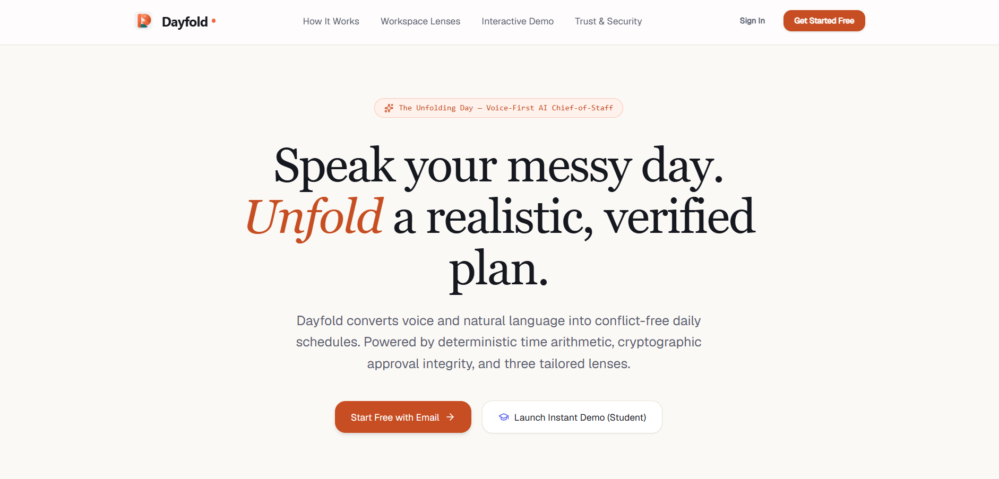
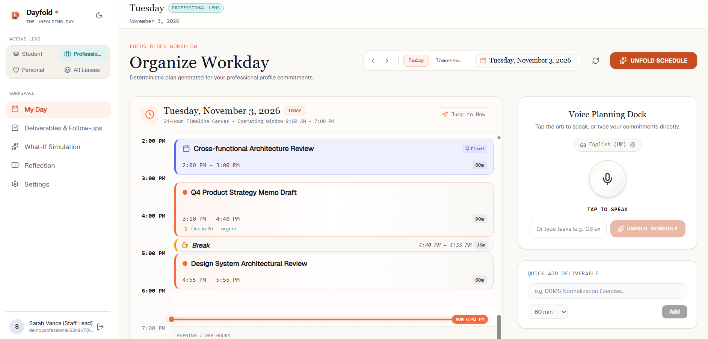
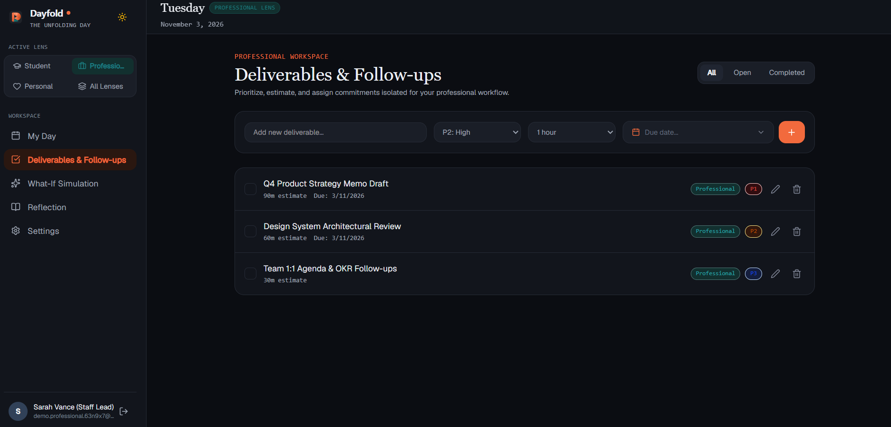
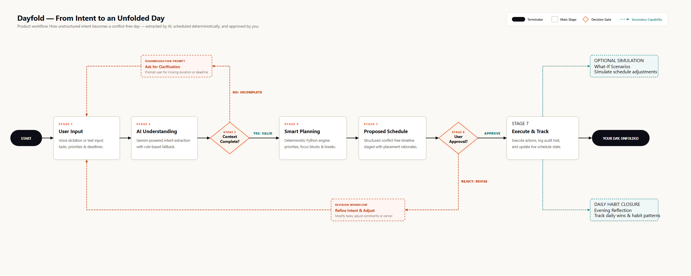

-<div align="center">

# Dayfold

### An AI Chief of Staff for Everyday Decisions.

*The Unfolding Day*

</div>

> **Talk naturally. Plan intelligently. Unfold your day.**

Dayfold is an intelligent planning companion that converts natural-language responsibilities, priorities, and commitments into a realistic, structured daily schedule.

Its central engineering principle is:

> **AI understands intent. A deterministic planning engine constructs the schedule. The user retains control through explicit approval.**

All time calculations, interval arithmetic, and placement decisions are executed by deterministic Python logic rather than the LLM, preventing calendar hallucinations and unverified schedule mutations.

---

## Product Preview

> *The screenshots below capture Dayfold's interactive demo workspace and landing interface running in the local development environment.*

### Landing Interface — The Unfolding Day
The entry point introduces the core philosophy: conversational capture paired with structured, workable time allocation.



### Central Planning Experience — 24-Hour Timeline Dashboard
The primary workspace brings together natural-language intent capture, live timeline visualization with active NOW markers, contextual lenses, and human-in-the-loop approval cards.



### Deliverables & Actionable Commitments
Beyond time slots, Dayfold tracks actionable deliverables, scheduled commitments, and follow-ups with transparent placement rationales.



---

## What Dayfold Does

Every day, people navigate an influx of commitments: work tasks, lectures, study blocks, meetings, deadlines, and personal errands. Turning these into a workable day usually requires tedious manual calendar arithmetic: estimating durations, finding free gaps, calculating transit buffers, avoiding collisions, and constantly rescheduling when plans slip.

Naive LLM productivity assistants attempt to schedule by generating calendar dates directly within text. This frequently leads to temporal hallucinations, overlapping commitments, invalid durations, and unverified calendar mutations.

**Dayfold resolves this by decoupling language understanding from mathematical scheduling:**

1. **Conversational Intent Capture**: You express what you need to accomplish using natural speech or text (*"Need to review operating systems lecture for 2 hours before 4pm, team standup at 10am, then study for 90 minutes"*).
2. **Deterministic Time Optimization**: A pure Python scheduling engine calculates available working intervals, prioritizes by deadline urgency, bounds tasks by focus block thresholds, guards transition buffers, and inserts restorative rest breaks.
3. **Integrity-Verified Approval Gate**: Dayfold never modifies your active schedule autonomously. Every proposed change is staged as an immutable pending action sealed with a SHA-256 payload hash. Nothing takes effect until you explicitly inspect and approve it.

---

## How Dayfold Works

The diagram below outlines the seven-stage journey from unstructured human thought to an executed, workable day:



### The 7-Stage Core Workflow

1. **User Input**: Express natural thoughts through spoken voice dictation (`VoiceOrb`) or text input (`Omnibar`), specifying tasks, priorities, estimated durations, and deadlines.
2. **AI Understanding**: The Google GenAI SDK (Gemini 3.6 Flash) extracts structured entities (`FlexibleActivity`, `FixedCommitment`, `Ambiguity`) against rigid Pydantic schemas. If the AI service is unreachable or unconfigured, Dayfold automatically falls back to an internal deterministic NLP/regex parser.
3. **Context Validation**: A decision gate evaluates whether the extracted information contains sufficient detail. If critical parameters are ambiguous, Dayfold generates a clarifying question prompt rather than guessing missing bounds.
4. **Smart Planning**: Deterministic Python logic handles scheduling calculations instead of the LLM: computing available working intervals, scoring tasks by deadline urgency, enforcing focus block limits (e.g. 90 minutes), and inserting breaks (e.g. 15 minutes).
5. **Proposed Schedule**: A structured, workable schedule is generated with placement rationales for every block and staged as an immutable `PendingAction`.
6. **User Review & Approval**: The user reviews the proposal on an interactive `ApprovalCard`.
   - **Reject**: Triggers the revision flow, allowing the user to refine constraints or adjust tasks with zero calendar mutations.
   - **Approve**: Verifies the SHA-256 payload hash to prevent stale execution before triggering the execution pipeline.
7. **Execute & Track**: Executes the approved action, updates scheduled tasks to in-progress, logs the event to the append-only audit trail, and renders the live schedule on the 24-hour timeline.
   - **Secondary Branch — What-If Scenarios**: Safely simulate hypothetical schedule trade-offs in an isolated sandbox without altering live calendar records.
   - **Secondary Branch — Evening Reflection**: Complete the day with a structured review of accomplishments, friction points, and habit patterns for weekly synthesis.

---

## Core Features

### 1. Voice & Text Planning
- **VoiceOrb Dictation**: Hands-free voice capture leveraging browser Web Speech recognition for natural dictation.
- **Omnibar Input**: Universal command bar for quick text entry, rapid task capture, and conversational scheduling queries.
- **Multimodal Capture**: Supports flexible activities, locked calendar appointments, and duration constraints in one command.

### 2. AI-Powered Intent Understanding
- **Schema-Constrained Extraction**: Leverages Gemini 3.6 Flash with Pydantic schemas to validate and structure extracted activity and constraint payloads.
- **Ambiguity Detection**: Flags uncertain durations or incomplete time bounds, converting them into clarifying questions rather than guessing.
- **Deterministic Fallback**: Local regex and heuristic parser activates when Gemini is unconfigured or unreachable, providing local extraction without requiring an active API key (as a fallback parser, not full offline application sync).

### 3. Deterministic Schedule Generation
- **Pure Python Scheduling Engine**: Mathematical interval arithmetic, collision avoidance, and deadline scoring executed strictly in Python—zero LLM involvement in calendar math.
- **Focus Block Splitting**: Splits long tasks exceeding maximum focus block duration (default 90 min) into manageable blocks separated by rest periods.
- **Transition Buffers**: Enforces guard times (default 10 min) before and after fixed commitments to account for context switching.
- **Placement Rationales**: Every scheduled block carries an explanatory rationale code explaining why it was placed at that specific time.

### 4. Contextual Profile Lenses
- **Student Lens**: Tailored for classes, study sessions, exam countdowns, assignment deadlines, and academic deep work.
- **Professional Lens**: Balances collaborative meetings, deep work focus blocks, administrative intervals, and project milestones.
- **Personal Lens**: Organizes personal routines, habits, family commitments, and errand hours.

### 5. What-If Schedule Simulations
- **Sandboxed Experiments**: Test schedule adjustments (e.g., adding an emergency meeting or shortening available hours) in an isolated draft state.
- **Zero Production Mutation**: Simulations run in-memory and draft database states, automatically pruned after 24 hours without affecting the active timeline.

### 6. Dayfold Reflection & Insights
- **Three Reflection Anchors**: Daily journaling capturing *Accomplishments*, *Friction Points*, and *Next Intent*.
- **Weekly Trend Discovery**: Analyzes completed tasks, friction causes, and focus metrics across days to identify productivity patterns.

### 7. Integrity-Verified Approval Gate
- **Immutable PendingAction**: Schedule proposals are staged as immutable database records with expiration timestamps.
- **SHA-256 Tamper Protection**: The client sends the payload hash upon approval; execution aborts if the proposal changed between display and confirmation.
- **Explicit Rejection**: Rejections are recorded and discard the draft cleanly with zero calendar mutations.

### 8. Security & Auditability
- **Dual-Mode Authentication**: Bearer token headers for programmatic API access alongside HttpOnly, SameSite cookies for browser sessions.
- **Double-Submit CSRF Validation**: Verifies cryptographic CSRF tokens on all state-changing browser requests (`POST`, `PUT`, `PATCH`, `DELETE`).
- **Append-Only Audit Trail**: Every proposed, approved, rejected, or executed action is immutably logged with actor, timestamp, and target entity metadata.

---

## Technology Stack


| Layer | Technologies | Purpose in Dayfold |
|---|---|---|
| **Frontend** | **React 19** · **TypeScript** | Component-based interface and typed frontend application logic. |
| **UI & Tooling** | **Vite 6** · **Tailwind CSS v4** | Development server, production builds, and responsive styling. |
| **State & Networking** | **Zustand** · **React Router** · **Axios** | Client state management, navigation, and API communication. |
| **Backend** | **Python 3.10+** · **FastAPI** | Asynchronous REST APIs and application services. |
| **Validation & ORM** | **Pydantic v2** · **SQLAlchemy 2.0** | Request validation, configuration, and asynchronous database access. |
| **Database & Migrations** | **SQLite** · **PostgreSQL** · **Alembic** | Local development, PostgreSQL support, and version-controlled schema migrations. |
| **Distributed Infrastructure** | **Redis** | Multi-worker rate limiting and token revocation, with an in-memory fallback. |
| **AI Integration** | **Google GenAI SDK (Gemini)** | Structured natural-language extraction with schema validation. |
| **Fallback NLP** | **Custom Python NLP / Regex** | Rule-based parsing when the Gemini API is unavailable. |
| **Security** | **bcrypt** · **python-jose** · **SHA-256** | Password hashing, JWT authentication, and action payload integrity verification. |

---

## Engineering Highlights

### 1. Separation of Concerns: Language vs. Scheduling
Large language models should never perform arithmetic scheduling. LLMs excel at parsing nuanced human prose into semantic structures. Conversely, deterministic algorithms excel at interval arithmetic, constraint satisfaction, and collision resolution. Dayfold strictly limits AI to semantic parsing, handing the structured output to a deterministic Python engine.

### 2. Constraint-Aware Schedule Construction
The scheduling engine (`backend/app/services/planner/engine.py`) employs a deterministic greedy interval scheduling algorithm with priority and deadline urgency scoring:
- Filters out non-working hours based on user preferences.
- Locks fixed appointments (`CalendarEvent`) in place as hard obstacles.
- Computes available free intervals.
- Scores tasks based on priority, deadline proximity, and duration.
- Greedily places highest-scoring tasks into available free intervals.
- Splits tasks exceeding focus limits (default 90 min) and inserts restorative breaks (default 15 min).

### 3. Cryptographic Action Integrity
To prevent race conditions, stale execution, or unauthorized payload modification between when a schedule is reviewed and when it is approved:
- A canonical SHA-256 digest is computed over the proposed plan payload at staging time.
- The client submits this hash upon approval (`POST /actions/{id}/approve`).
- The backend recalculates and verifies the hash before running `_execute_action`. Any mismatch immediately rejects the request with HTTP 409 Conflict.

### 4. Append-Only Audit Logging
All state transitions—whether a schedule is generated, an action is staged, a proposal is approved, or an action is rejected—are recorded in an immutable `audit_log` table, providing a transparent operational history.

### 5. Seamless AI Fallback
Dayfold does not hard-fail if the Gemini API key is missing, network access is restricted, or quota limits are reached. The agent automatically detects unavailability and switches to the deterministic rule-based parser (`extractor.py`), allowing intent extraction to proceed without an active AI key.

### 6. Sandboxed Schedule Simulation
What-If planning operates by creating draft plans flagged with `is_simulation = True`. Users can test hypothetical scenarios without risk of overwriting committed schedules. A background pruning utility automatically cleans up stale draft simulations older than 24 hours.

---

## Development Roadmap

```
[ IMPLEMENTED ] ──────────────────> [ IN PROGRESS ] ───────────────> [ PLANNED ]
• Voice & Text Intent Capture       • External Calendar 2-Way Sync   • End-to-End Encrypted Sync
• Gemini 3.6 Flash Extraction       • Recurrence Rule Engine         • Multi-Agent Collaboration
• Pure Python Planning Engine       • Mobile Touch Timeline          • Native Wearable Voice Client
• Integrity-Verified Approval Gate
• SHA-256 Action Verification
• What-If Sandboxed Simulations
• Reflection & Habit Analytics
• Dual-Mode Auth & CSRF Security
```

### Implemented & Verified
- [x] Spoken voice dictation (`VoiceOrb`) and text `Omnibar` input.
- [x] Google GenAI SDK integration with Gemini 3.6 Flash and Pydantic schema validation.
- [x] Deterministic heuristic regex/NLP fallback parser when AI is unconfigured or unreachable.
- [x] Pure Python interval planning engine with focus block limits, breaks, and buffers.
- [x] Three profile lenses: Student, Professional, and Personal.
- [x] Staged `PendingAction` workflow with SHA-256 payload integrity validation.
- [x] Interactive `ApprovalCard` UI with explicit user confirmation and rejection paths.
- [x] Action execution engine transitioning plan and task statuses upon approval.
- [x] Append-only audit logging across all state transitions.
- [x] Sandboxed What-If schedule simulation with automatic 24-hour draft cleanup.
- [x] Daily Reflection journaling (Accomplishments, Friction, Next Intent) and weekly review synthesis.
- [x] Dual-mode authentication (Bearer JWT & HttpOnly cookies) with double-submit CSRF protection.
- [x] Multi-worker Redis token revocation and rate limiting with local in-memory fallback.
- [x] Relational database persistence with full linear Alembic migrations.

### In Progress
- [ ] Bi-directional calendar synchronization with external providers (Google Calendar, Outlook, CalDAV).
- [ ] Automated recurring rule engine (RRULE support for repeating tasks and fixed events).
- [ ] Touch-optimized timeline block drag-and-drop and pinch-to-zoom for mobile browsers.

### Planned
- [ ] End-to-end encrypted device-to-device local synchronization.
- [ ] Collaborative multi-agent delegation for shared team commitments.
- [ ] Native wearable and ambient voice-first interaction clients.

---

## Getting Started

### Prerequisites
- **Python**: 3.10 or higher
- **Node.js**: 18.0 or higher with **pnpm** installed
- **API Key (Optional)**: A Google Gemini API key from [Google AI Studio](https://aistudio.google.com/). If omitted, Dayfold runs using its built-in deterministic fallback parser.

### 1. Backend Setup

```bash
# Navigate to the backend directory
cd backend

# Create and activate a Python virtual environment
python -m venv venv

# Windows (PowerShell):
.\venv\Scripts\Activate.ps1
# macOS / Linux:
source venv/bin/activate

# Install backend dependencies
pip install -r requirements.txt

# Create your local environment file
cp .env.example .env

# Run database migrations to initialize tables
alembic upgrade head

# Start the local development server
python run.py
```

*The backend server will start at `http://127.0.0.1:8000`.*
*Interactive API documentation is available at `http://127.0.0.1:8000/docs`.*

### 2. Frontend Setup

```bash
# Open a new terminal and navigate to the frontend directory
cd frontend

# Install frontend dependencies using pnpm
pnpm install

# Start the Vite development server
pnpm dev
```

*The frontend application will start at `http://localhost:5173`.*
*In development mode, API requests are automatically reverse-proxied to `http://127.0.0.1:8000`.*

---

## Project Structure

```
dayfold/
├── docs/
│   ├── diagrams/             # Architecture and workflow diagrams
│   │   ├── dayfold-architecture.svg
│   │   ├── dayfold-product-flow.mmd    # Editable Mermaid workflow source
│   │   └── dayfold-product-flow.png    # High-resolution product flowchart
│   └── images/               # Product showcase screenshots
│       ├── dayfold-landing.png
│       ├── dayfold-dashboard.png
│       └── dayfold-deliverables.png
├── backend/
│   ├── alembic/              # Database migration scripts
│   ├── app/
│   │   ├── api/routes/       # REST endpoints (auth, actions, planning, tasks, etc.)
│   │   ├── core/             # Security, JWT, CSRF, Redis store, configuration
│   │   ├── db/               # SQLAlchemy engine, session lifecycle, base model
│   │   ├── models/           # Declarative database models
│   │   ├── schemas/          # Pydantic request and response schemas
│   │   └── services/
│   │       ├── agent/        # Gemini extractor and rule-based heuristic parser
│   │       ├── planner/      # Pure Python deterministic scheduling engine
│   │       ├── auth/         # Password hashing and token services
│   │       └── reflection/   # Journaling analysis and weekly pattern discovery
│   ├── requirements.txt      # Python dependencies
│   ├── alembic.ini           # Migration environment configuration
│   └── run.py                # Local server runner
└── frontend/
    ├── src/
    │   ├── components/       # Interface components (VoiceOrb, Timeline, ApprovalCard)
    │   │   └── reflection/   # Journaling and weekly review widgets
    │   ├── hooks/            # Custom React hooks (voice recording, theme)
    │   ├── lib/              # Axios API client with token and CSRF handling
    │   ├── pages/            # Page views (MyDay, WhatIf, Tasks, Journal, Settings)
    │   └── store/            # Zustand state stores (auth, workspace, voice)
    ├── package.json          # Node dependencies
    ├── pnpm-lock.yaml        # Pnpm lockfile
    ├── vite.config.ts        # Vite configuration and development proxy
    └── vercel.json           # Production frontend deployment specification
```

---

## Future Development

Dayfold's long-term roadmap focuses on deepening trust, cross-platform ubiquity, and context awareness:

- **Unified Calendar Protocols**: Native CalDAV, Google Calendar, and Microsoft Graph bi-directional event synchronization.
- **Local-First Synchronization**: Cryptographically signed CRDT-based event replication between personal devices without cloud dependence.
- **Ambient Voice Surface**: Wearable and smart-speaker voice interfaces capable of streaming quick voice updates without opening a browser.
- **Context-Aware Energy Calibration**: Learning historical completion times to dynamically recalibrate estimated focus block durations.

---

## The Unfolding Day

> **Talk naturally. Plan intelligently. Unfold your day.**

Dayfold is built on the belief that everyday productivity should feel calm, transparent, and respectful of human agency. By combining the conversational ease of generative AI with the reliability of deterministic scheduling and explicit user approval, Dayfold transforms overwhelming responsibilities into a structured day that works for you.
